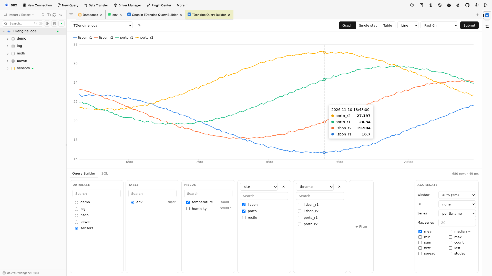
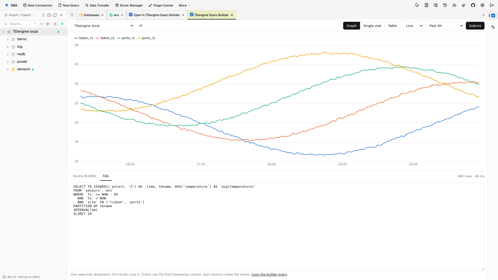
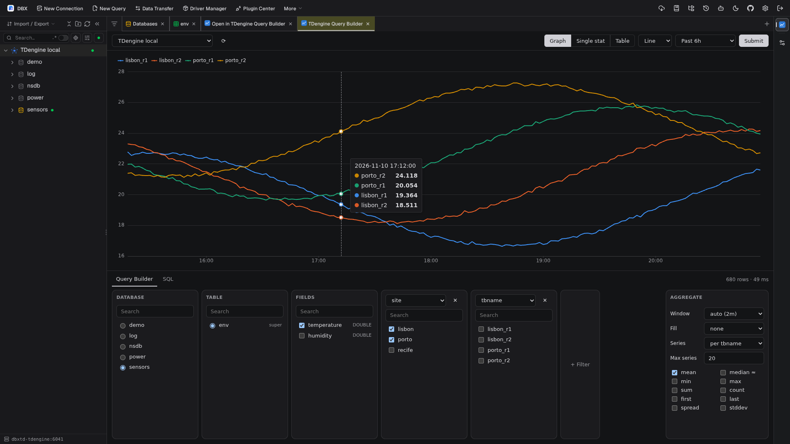
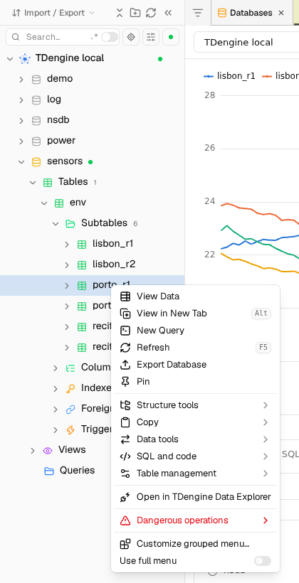

# TDengine Data Explorer for DBX

A [DBX](https://github.com/t8y2/dbx) plugin modeled on the InfluxDB 2 Data Explorer, for TDengine connections: pick a database and supertable, narrow it with cascading tag filters, choose fields and aggregate functions, and chart the result as a time series.



| SQL tab | Dark theme | Table context menu |
| --- | --- | --- |
|  |  |  |

New to DBX plugins? [`docs/dbx-plugin-system.md`](docs/dbx-plugin-system.md) explains how they are packaged, sandboxed and allowed to read data. Coding agents start at [`AGENTS.md`](AGENTS.md).

- **Cards like the InfluxDB builder:** Database → Table → Fields → any number of tag filter cards. Each filter card lists the values left after the cards on its left (`SELECT DISTINCT tag … WHERE <earlier filters>`), `tbname` included.
- **Aggregate panel:** window (`auto` keeps every series under the row cap, ~360 points like InfluxDB), fill, one series per child table / per tag / merged, max series, and mean, median ≈, min, max, sum, count, first, last, spread, stddev.
- **Raw mode:** window "none (raw)" plots the latest 5000 points in the range, one series per child table, without aggregation.
- **Views:** graph (line, step, points; crosshair tooltip with every series), single stat, table.
- **Auto-refresh:** every 10s, 30s, 1m or 5m for relative ranges; it pauses while the chart is zoomed and turns off on any error.
- **SQL tab:** shows the generated SQL; edit it or write your own read-only query (Ctrl+Enter).
- **Saved queries:** name a builder or SQL query and reopen it from any tab; it applies to the open connection and waits for Submit.
- **Languages:** English, Simplified Chinese and Brazilian Portuguese, following the DBX language.
- **Entry points:** the app toolbar / command palette, and **Open in TDengine Data Explorer** on a table's context menu. A child table opens as its supertable filtered to that `tbname`.

## How it works

It is a frontend-only (`universal`) plugin. There is no sidecar and no driver: every query goes through the Host API `window.dbxPlugin.queryData` on the TDengine connection DBX already has open, so DBX keeps credentials, tunnels and the read-only check. DBX asks once per connection before the first query; the grant can be revoked in Plugin Center.

A builder query looks like this (TDengine 3.x):

```sql
SELECT TO_ISO8601(_wstart, 'Z') AS _time, tbname, AVG(`current`) AS `avg(current)`
FROM `power`.`meters`
WHERE `ts` >= NOW - 1h
  AND `ts` < NOW
  AND `location` IN ('California.SanFrancisco')
PARTITION BY tbname
INTERVAL(10s)
SLIMIT 20
```

Metadata comes from `information_schema.ins_databases`, `ins_stables`/`ins_tables` and `DESCRIBE`.

Permissions: `host.data:read` (queries), `host.connections:read` (connection picker), `host.storage` (builder state per tab and saved queries). Requires Host API `^1.4`.

## Install

Download `io.github.andersou.tdengine-data-explorer-<version>-universal.dbxp` from the [latest release](https://github.com/andersou/dbx-plugin-tdengine-data-explorer/releases/latest) and install it with **Plugin Center → Settings → Install .dbxp**. The desktop app can also take the asset URL in **Install from URL**; the web build fetches that URL from the browser, which GitHub release assets block (CORS), so upload the file there.

The package is not signed by the DBX Store yet: enable **Allow unsigned development packages** in the same settings page, and on the web/Docker build also start DBX with `DBX_ALLOW_UNSIGNED_PLUGINS=1` (needed only while installing).

## Develop

```bash
npm install
npm run build          # src/ -> ui/ (one chunk on purpose, see vite.config.js)
npm test               # SQL builder, series pivot, saved queries and translations
TDENGINE_URL=http://localhost:6041 npm test   # also runs every generated query on a real TDengine
npx dbx-plugin package .                      # dist/*-0.0.0-dev-universal.dbxp (unsigned)
```

The integration test expects `taosBenchmark -y -d power` data. `dbx-plugin dev` (the SDK browser host) only mocks the Host API and cannot run `queryData`, so test data flows in a real DBX:

1. Plugin Center → Settings → enable **Allow unsigned development packages**, then install the `.dbxp`. The web/Docker build additionally needs `DBX_ALLOW_UNSIGNED_PLUGINS=1` on the server.
2. Connect to a TDengine connection, then open the builder from the toolbar icon or a table's context menu.

## Limits

- `queryData` returns at most 5000 rows; a truncated result says so in the status line. Shorten the range, widen the window or lower max series.
- Max series (1 to 100) is applied with `SLIMIT`, so a supertable with more child tables shows only some of them; the status line says when a result reaches the limit.
- DBX cannot scope context-menu entries to one database type, so the table menu entry also shows on other connections; the builder refuses non-TDengine connections without querying them.
- Timestamps in hand-written SQL are read in the server time zone with one fixed offset (`SELECT timezone()`); builder queries are exact because they use `TO_ISO8601(…, 'Z')`.
- Auto-refresh keeps running while its DBX tab is in the background: Host API 1.4 gives plugins no tab-visibility signal.
- Raw mode cannot return the latest N points of every series in one query (TDengine sorts `PARTITION BY` output as one stream under `ORDER BY`), so busy child tables can fill most of the 5000 points; the status line says when the cap hides older points.
- Host and TDengine error messages stay in English.
- Dropped: a `result-view` button for DBX's SQL editor. DBX already charts SQL-editor results natively, the button would appear on every database type, and its snapshot is capped at 500 rows without column types; the SQL tab covers the same need with up to 5000 rows.

## Releases

`.github/workflows/ci-release.yml` runs on every push and pull request to `main` and `develop`: unit and TDengine integration tests (against `tdengine/tdengine:3.3.6.13`), the UI build and the `.dbxp`. On pushes, semantic-release picks the version from [Conventional Commits](https://www.conventionalcommits.org/) (`feat` → minor; `fix`, `perf`, `revert` → patch; breaking change → major) and publishes a `vX.Y.Z` GitHub release with the `.dbxp`, its `.artifact.json` (target, URL, SHA-256 and size for a DBX Store candidate) and `SHA256SUMS`; `develop` publishes `-beta` prereleases. The version is stamped into `manifest.json` at build time, so the file keeps `0.0.0-dev` in git and no release commit is made.

Plugin ID `io.github.andersou.tdengine-data-explorer`, publisher `andersou`.
